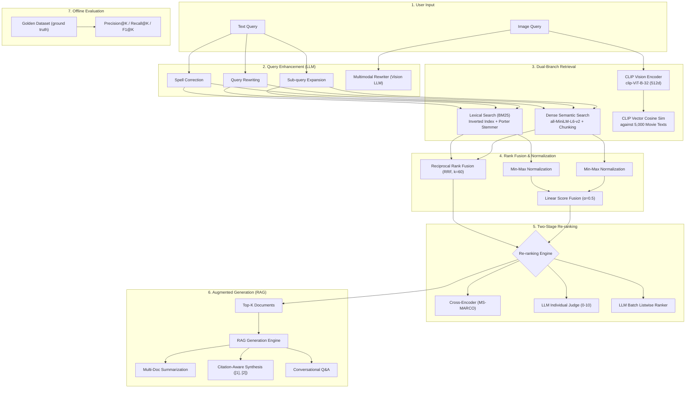

# 🎬 Webflyx: Advanced Hybrid RAG & Multimodal Search Engine

An end-to-end, production-grade Information Retrieval (IR) and Retrieval-Augmented Generation (RAG) system built in Python for **Webflyx** (a curated 5,000-movie streaming catalog).

This repository implements industry-standard search architectures from scratch, progressing from classical lexical search (BM25) to dense semantic vector search, hybrid rank fusion (RRF), multi-stage LLM re-ranking, rigorous evaluation against golden datasets, conversational RAG with citations, and zero-shot multimodal vision search powered by OpenAI's CLIP.

---

## 📑 Table of Contents
1. [Architecture Overview](#-architecture-overview)
2. [Core Search Paradigms](#-core-search-paradigms)
3. [Mathematical Foundations & Algorithms](#-mathematical-foundations--algorithms)
4. [Project Structure](#-project-structure)
5. [Installation & Setup](#-installation--setup)
6. [CLI Command Reference](#-cli-command-reference)
   - [1. Lexical / Keyword Search (BM25)](#1-lexical--keyword-search-bm25)
   - [2. Dense Semantic Search & Chunking](#2-dense-semantic-search--chunking)
   - [3. Hybrid Search, Query Transformations & Re-ranking](#3-hybrid-search-query-transformations--re-ranking)
   - [4. Search Quality Evaluation Suite](#4-search-quality-evaluation-suite)
   - [5. Retrieval-Augmented Generation (RAG)](#5-retrieval-augmented-generation-rag)
   - [6. Multimodal Vision Search](#6-multimodal-vision-search)
7. [Engineering Lessons & Design Decisions](#-engineering-lessons--design-decisions)

---

## 🏛 Architecture Overview



---

## 🔍 Core Search Paradigms

| Paradigm | Module | Strengths | Limitations |
| :--- | :--- | :--- | :--- |
| **Lexical (BM25)** | `keyword_search.py` | Exact keyword matches, acronyms, actor names, fast inverted index lookup. | Vocabulary mismatch problem (synonyms, typos, paraphrasing). |
| **Dense Semantic** | `semantic_search.py` | Understands conceptual meaning, themes, emotions, and intent across languages. | Can struggle with specific rare keywords, numbers, or exact proper nouns. |
| **Chunked Semantic** | `semantic_search.py` | Resolves loss of detail in long documents by chunking text and aggregating scores. | Requires additional index storage and chunk-to-parent mapping. |
| **Hybrid (RRF)** | `hybrid_search.py` | Combines strengths of both lexical and semantic channels without fragile score tuning. | Requires running multiple search pipelines in parallel. |
| **Cross-Encoder Re-ranker** | `hybrid_search_cli.py` | Deep cross-attention between query and document tokens for high precision. | Higher latency than bi-encoders; best suited as a second-stage filter on top-K. |
| **Multimodal (CLIP)** | `multimodal_search.py` | True cross-modal search: maps images and text into a shared 512-dimensional vector space. | Smaller local models have domain-specific accuracy tradeoffs. |

---

## 🧮 Mathematical Foundations & Algorithms

### 1. BM25 (Best Matching 25)
Calculates relevance of document $D$ for query $Q = \{q_1, \dots, q_n\}$:

$$\text{BM25}(D, Q) = \sum_{i=1}^n \text{IDF}(q_i) \cdot \frac{f(q_i, D) \cdot (k_1 + 1)}{f(q_i, D) + k_1 \cdot \left(1 - b + b \cdot \frac{|D|}{\text{avgdl}}\right)}$$

- **Parameters used**: $k_1 = 1.5$ (term frequency saturation), $b = 0.75$ (document length penalty).
- **Inverse Document Frequency (IDF)**:

$$\text{IDF}(q_i) = \ln\left(\frac{N - n(q_i) + 0.5}{n(q_i) + 0.5} + 1\right)$$

### 2. Cosine Similarity
Measures angular alignment between dense embedding vectors $\vec{u}$ and $\vec{v}$:

$$\text{CosineSimilarity}(\vec{u}, \vec{v}) = \frac{\vec{u} \cdot \vec{v}}{\|\vec{u}\|_2 \cdot \|\vec{v}\|_2} = \frac{\sum u_i v_i}{\sqrt{\sum u_i^2} \sqrt{\sum v_i^2}}$$

### 3. Min-Max Score Normalization
Maps unbounded scores (such as raw BM25 scores) into a uniform range $[0, 1]$ before linear combination:

$$S_{\text{norm}}(d) = \frac{S(d) - \min(S)}{\max(S) - \min(S)}$$

### 4. Reciprocal Rank Fusion (RRF)
Combines multiple ranked lists without requiring score scale calibration:

$$\text{RRF}(d) = \sum_{m \in M} \frac{1}{k + r_m(d)}$$

- $M$: set of retrieval systems (e.g., Lexical and Semantic).
- $r_m(d)$: rank position of document $d$ in system $m$ (1-indexed).
- $k = 60$: smoothing constant mitigating outlier domination.

### 5. Evaluation Metrics
Evaluated against a curated ground-truth golden dataset:
- **Precision@K**: $\frac{|\text{Relevant} \cap \text{Retrieved@K}|}{K}$
- **Recall@K**: $\frac{|\text{Relevant} \cap \text{Retrieved@K}|}{|\text{Total Relevant}|}$
- **F1 Score@K**: $2 \cdot \frac{\text{Precision@K} \cdot \text{Recall@K}}{\text{Precision@K} + \text{Recall@K}}$

---

## 📁 Project Structure

```text
rag-search-engine/
├── cli/
│   ├── lib/
│   │   ├── keyword_search.py       # InvertedIndex, BM25 scoring, tokenization & stemming
│   │   ├── semantic_search.py      # Dense vector search, embeddings, sliding & semantic chunking
│   │   ├── hybrid_search.py        # Min-max normalization, Weighted fusion, RRF search
│   │   └── multimodal_search.py    # CLIP model loading, image embeddings, image-to-text search
│   ├── keyword_search_cli.py       # CLI commands for lexical search & index inspection
│   ├── semantic_search_cli.py      # CLI commands for dense embeddings & chunked search
│   ├── hybrid_search_cli.py        # CLI for hybrid search, query rewriting, re-ranking & LLM judge
│   ├── evaluation_cli.py           # Evaluation framework (Precision@K, Recall@K, F1)
│   ├── augmented_generation_cli.py # RAG commands (rag, summarize, citations, question)
│   ├── describe_image_cli.py       # Multimodal query rewriting via Vision LLM
│   └── multimodal_search_cli.py    # CLI commands for zero-shot image-to-text search
├── data/
│   ├── movies.json                 # Curated dataset of 5,000 movies
│   ├── golden_dataset.json         # Benchmark queries and ground-truth relevant IDs
│   ├── stopwords.txt               # Custom stopword list for lexical preprocessing
│   └── paddington.jpeg             # Test image for multimodal evaluation
├── cache/                          # Cached embeddings (.npy) and precomputed indexes
├── pyproject.toml                  # Project metadata, dependencies, and lockfile
└── README.md                       # Comprehensive documentation & architecture guide
```

---

## 🚀 Installation & Setup

### Prerequisites
- Python 3.12+
- [`uv`](https://docs.astral.sh/uv/) (ultra-fast Python package and project manager)
- OpenRouter API Key (for LLM generation and vision query rewriting)

### 1. Clone & Install Dependencies
```bash
git clone <repo-url>
cd rag-search-engine

# Sync dependencies using uv
uv sync
```

### 2. Environment Configuration
Create a `.env` file in the project root:
```env
OPENROUTER_API_KEY=your_openrouter_api_key_here
```

---

## 💻 CLI Command Reference

### 1. Lexical / Keyword Search (BM25)

Build, inspect, and query an inverted index using BM25 ranking:

```bash
# Build the inverted index from data/movies.json
uv run cli/keyword_search_cli.py build

# Inspect vocabulary term frequency and document frequency
uv run cli/keyword_search_cli.py inspect "spaceship"

# Search movies using BM25 with custom limit
uv run cli/keyword_search_cli.py search "time travel paradox" --limit 5
```

---

### 2. Dense Semantic Search & Chunking

Generate and search vector embeddings using `sentence-transformers` (`all-MiniLM-L6-v2`):

```bash
# Verify the embedding model and print embedding dimensions (384d)
uv run cli/semantic_search_cli.py verify

# Generate or load document embeddings
uv run cli/semantic_search_cli.py verify_embeddings

# Basic dense semantic search
uv run cli/semantic_search_cli.py search "cozy animated family film" --limit 5

# Sliding-window token chunking with overlap
uv run cli/semantic_search_cli.py chunk "This is a long movie description..." --chunk-size 200 --overlap 20

# Natural sentence-boundary semantic chunking
uv run cli/semantic_search_cli.py semantic_chunk "Sentence one. Sentence two. Sentence three." --max-chunk-size 2 --overlap 0

# Generate chunked embeddings cache
uv run cli/semantic_search_cli.py embed_chunks

# Search using chunked embeddings (maps best chunk to parent movie)
uv run cli/semantic_search_cli.py search_chunked "dramatic space rescue mission" --limit 5
```

---

### 3. Hybrid Search, Query Transformations & Re-ranking

Combine BM25 and Semantic search, apply query rewrites, and re-rank with Cross-Encoders or LLMs:

```bash
# Weighted hybrid search (linear fusion: alpha * BM25 + (1 - alpha) * Semantic)
uv run cli/hybrid_search_cli.py weighted "artificial intelligence rebellion" --alpha 0.5 --limit 5

# Reciprocal Rank Fusion (RRF) - robust rank-based merging
uv run cli/hybrid_search_cli.py rrf "cyberpunk neon heist" --limit 5

# Hybrid search with automated spelling correction
uv run cli/hybrid_search_cli.py rrf "dinosour jurasic park" --enhance spell

# Hybrid search with query rewriting (clarifying intent)
uv run cli/hybrid_search_cli.py rrf "scary movie with clown in sewer" --enhance rewrite

# Hybrid search with query expansion (generating multi-angle sub-queries)
uv run cli/hybrid_search_cli.py rrf "space exploration disaster" --enhance expand

# Re-ranking top candidates using a Cross-Encoder (MS-MARCO)
uv run cli/hybrid_search_cli.py rrf "detective serial killer puzzle" --rerank-method cross_encoder --limit 5

# Re-ranking using individual LLM relevance scores (0-10 scale)
uv run cli/hybrid_search_cli.py rrf "funny buddy cop comedy" --rerank-method individual --limit 5

# Re-ranking using batch listwise LLM evaluation
uv run cli/hybrid_search_cli.py rrf "submarine war thriller" --rerank-method batch --limit 5

# Automated LLM-as-a-judge relevance evaluation on search output
uv run cli/hybrid_search_cli.py rrf "superhero origin story" --evaluate
```

---

### 4. Search Quality Evaluation Suite

Quantitatively compare retrieval algorithms against `data/golden_dataset.json`:

```bash
# Evaluate BM25 Lexical Search (Precision, Recall, F1)
uv run cli/evaluation_cli.py evaluate --method bm25 --limit 5

# Evaluate Dense Semantic Search
uv run cli/evaluation_cli.py evaluate --method semantic --limit 5

# Evaluate Hybrid RRF Search
uv run cli/evaluation_cli.py evaluate --method rrf --limit 5
```

---

### 5. Retrieval-Augmented Generation (RAG)

Leverage OpenRouter LLMs to synthesize answers and summaries from retrieved movie context:

```bash
# Basic RAG: Generates synthesized answer conditioned on top search results
uv run cli/augmented_generation_cli.py rag "Recommend three thought-provoking psychological thrillers"

# Multi-Document Summarization: Synthesizes consistent themes across search results
uv run cli/augmented_generation_cli.py summarize "movies about survival in the arctic"

# Citation-Aware Synthesis: Returns output with verifiable sources [1], [2]
uv run cli/augmented_generation_cli.py citations "intense wilderness bear encounters"

# Conversational Question Answering: Direct, natural conversational response
uv run cli/augmented_generation_cli.py question "Who are the main characters in Jurassic Park?"
```

---

### 6. Multimodal Vision Search

Search for movies using images via Vision LLM rewriting and CLIP zero-shot vector matching:

```bash
# Approach A: Multimodal Query Rewriting (Vision LLM converts Image + Text -> Search Query)
uv run cli/describe_image_cli.py --image data/paddington.jpeg --query "bear in London"

# Approach B: Verify local CLIP model embedding dimensions (512d)
uv run cli/multimodal_search_cli.py verify_image_embedding 'data/paddington.jpeg'

# Approach B: Full Image-to-Text Search (Direct image query against 5,000 movie texts)
uv run cli/multimodal_search_cli.py image_search 'data/paddington.jpeg'
```

---

## 🧠 Engineering Lessons & Design Decisions

1. **Why Bi-Encoders for Retrieval and Cross-Encoders for Re-ranking?**
   - Bi-encoders encode queries and documents independently into vector spaces. While extremely fast ($O(1)$ similarity search with pre-computed vectors), they cannot model token-level interactions between query and document.
   - Cross-encoders feed the query and document together through full transformer self-attention ($O(N^2)$), capturing subtle nuances. Because they cannot pre-compute embeddings, they are used strictly as a second-stage re-ranker on the top-20 candidates.

2. **RRF over Score-Based Fusion:**
   - Normalizing raw scores across disparate search algorithms (e.g., BM25 scores in $[0, \infty)$ vs. cosine similarities in $[-1, 1]$) is fragile and sensitive to outliers.
   - Reciprocal Rank Fusion (RRF) relies strictly on ordinal ranking positions, providing consistent, robust retrieval performance without requiring arbitrary hyperparameter re-tuning.

3. **Lossy Compression vs. Joint Vector Spaces in Multimodal Search:**
   - Image query rewriting uses a Vision LLM to convert an image into text descriptions. While practical for text-only search engines, it creates a bottleneck where visual nuance (colors, mood, artistic style) is compressed into subjective prose.
   - Contrastive multimodal models (CLIP) overcome this by projecting images and text directly into the same vector space, enabling true visual-semantic cross-modal retrieval.

4. **Chunking Tradeoffs:**
   - Document-level embeddings often suffer from the "needle-in-a-haystack" problem when averaging full movie plots.
   - Sentence-aware semantic chunking with overlap maintains coherent context windows and significantly improves recall for granular plot points and character arcs.

---

## 📜 License
This project was developed as part of the advanced RAG and search engineering curriculum on Boot.dev. Built by Musab for Webflyx.
